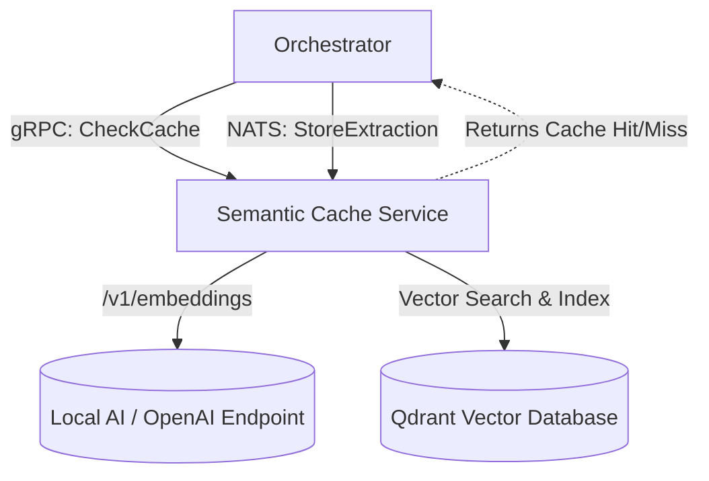

# Semantic Cache Service

Welcome to the Semantic Cache Service. It is a standalone microservice responsible for generating and storing mathematical embeddings of document texts. By caching these semantic signatures, upstream systems can bypass expensive LLM generations when encountering highly similar documents.

## Documentation Index
- [Core Components](./docs/01_Core_Components.md)
- [How To Implement](./docs/02_How_To_Implement.md)
- [Service Communication](./docs/03_Service_Communication.md)

## High-Level Architecture

